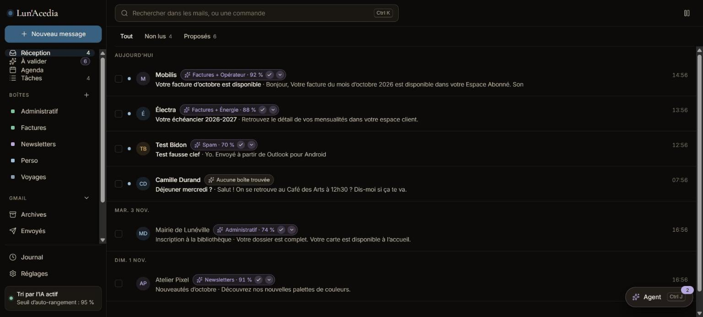

<div align="center">


# Lun'Acedia

**Ton courrier, ton agenda et tes tâches au même endroit, triés à la source et sous ton contrôle.**

Il remplace Gmail, Google Agenda et Google Tasks au quotidien, au bureau comme sur le téléphone. Tout tourne chez toi,
et rien ne quitte la boîte sans ton accord.

[](https://github.com/Lun-Ecosystem/lun-acedia/releases)
[](https://github.com/Lun-Ecosystem/lun-acedia/actions/workflows/ci.yml)
[](LICENSE)
[](https://nodejs.org)
[](https://svelte.dev)
[](https://github.com/Lun-Ecosystem)



</div>

## Ce qu'il fait

- **Le courrier** : la boîte Gmail, ses boîtes, étiquettes et règles, avec un tri par IA qui annonce sa confiance. Sous
  ton seuil, il propose ; au-dessus, il range.
- **L'agenda et les tâches** : Google Agenda (jour, semaine, mois, planning) et Google Tasks, dans la même app.
- **Un agent borné** : ses écritures deviennent des cartes à valider, ses suppressions le restent toujours, et il
  n'envoie jamais de mail (brouillon seulement). Neutre par défaut, son nom, son icône et son ton se règlent.
- **Une app installable** : une PWA servie par le serveur lui-même, sans magasin d'applications.

## Ce qu'il te faut

- Node `^22.13.0 || >=24`.
- Pour le vrai courrier, un client OAuth Google : [Brancher Google](docs/brancher-google.md). En développement, toujours
  un compte de test.
- Une clé de fournisseur d'IA, facultative : Anthropic, OpenAI ou Gemini, dans `.env` ou les Réglages.

## L'essayer sans compte

```bash
npm install
npm run build && npm run demo   # http://localhost:8797
```

Faux Gmail, faux agenda, faux tri, aucun compte Google, aucun réseau. La commande affiche le jeton d'appareil à coller
dans la console du navigateur.

## Démarrer en local

```bash
cp .env.example .env    # renseigner les clés de développement et le compte Google de test
npm install
npm run build           # construit le front, servi par le serveur à la racine
npm run dev             # http://localhost:8787
npm run pair-code       # dans un autre terminal, le code à saisir dans le front
```

Aucune dépendance au NAS : tout tourne sur le poste. Le serveur écoute sur `127.0.0.1` par défaut (`HOST` dans `.env`
pour une autre adresse). Le code d'appareil est à usage unique et vaut 10 minutes.

La base est copiée une fois par jour dans `backups/`, à côté d'elle (`data/backups/acedia-AAAA-MM-JJ.db` par défaut) :
dès que le serveur écoute, puis chaque heure si la copie du jour manque, ce qui rattrape un poste éteint la nuit. Les
sept dernières restent ; une copie ratée laisse une ligne au journal du serveur et se retente l'heure suivante. Relié
à Lun'Anima, elle lui envoie aussi un événement `backup.failed`, une fois par jour au plus, même en pause. Une
copie s'ouvre sans clé, comme la base : seuls les jetons Google et les clés d'IA saisies y restent chiffrés, et seule
la même `ACEDIA_SECRET_KEY` les relit. Restaurer une copie :
[Mettre le desktop en service](https://github.com/Lun-Ecosystem/lun-docs/blob/main/docs/mise-en-service-desktop.md#restaurer-une-copie),
dans lun-docs.

## Si ça coince

| Ce que tu vois | Quoi faire |
|---|---|
| Le serveur dit qu'il démarre sans Google | Renseigner `GOOGLE_CLIENT_ID`, `GOOGLE_CLIENT_SECRET` et `ACEDIA_SECRET_KEY` dans `.env` : [Brancher Google](docs/brancher-google.md). |
| Il faut reconnecter Google chaque semaine | L'écran de consentement est resté en statut « Test » : le publier en « Production », sans vérification. |
| Le serveur ne trouve pas le front | Lancer `npm run build`, qui construit `app/dist`. |
| Le code d'appareil est refusé | Après 5 codes faux en 10 minutes, ceux en cours sont annulés : en redemander un avec `npm run pair-code`. |
| Le téléphone ne propose pas d'installer l'app | Un navigateur n'installe une PWA qu'en HTTPS : [Installer sur le téléphone](docs/installer-sur-le-telephone.md). |

## Dans l'écosystème

**Rôle dans l'écosystème** : satellite. Il possède la boîte mail, son tri, l'agenda, les tâches et l'autorisation Google,
et il sert ses propres écrans. Il fonctionne seul. Lun'Anima s'y branche par le [contrat satellite](https://github.com/Lun-Ecosystem/lun-docs/blob/main/standards/contrat-satellite.md) (v1.4) : il délègue à son agent
(`POST /lun/v1/agent`) et relaie ses cartes (`GET /lun/v1/cards`, `accept`, `refuse`), sans intégrer ses écrans.

| Dossier | Contenu |
|---|---|
| `server/` | le serveur : synchro Google, tri, agenda, API du front, contrat `/lun/v1` |
| `views/` | les vues Svelte du front, en paquet interne (`@lun-ecosystem/lunacedia-views`) |
| `app/` | le front autonome (PWA), dont les composants métier viennent de `views/` |

## Documentation

- [`docs/`](docs/) : ce que fait le projet aujourd'hui, dont [Pina](docs/pina.md), l'agent, et [Prouver J1](docs/prouver-j1.md).
- [`docs/decisions/`](docs/decisions/) : les décisions propres au projet.
- Règles communes : [lun-docs](https://github.com/Lun-Ecosystem/lun-docs).

## Contribuer

Une branche, une PR avec critères de fin et preuves, CI verte. Seul CrOliX merge. Les règles viennent de
[lun-docs](https://github.com/Lun-Ecosystem/lun-docs).

## Licence

[MIT](LICENSE).
